<h1 align="center">Vision-Based Optical Simulation</h1>
<h3 align="center">Muscle Fatigue & Biomechanical Variable Prediction from Markerless Video</h3>

<p align="center">
  
  
  
  
  
  
</p>

<p align="center">
  <video src="https://idriss-jedid.github.io/Vision-Based-Optical-Simulation-for-Muscle-Fatigue-and-Biomechanical-Variable-Prediction/demo.mp4" controls muted loop width="860" poster="media/banner.gif"></video>
</p>

<p align="center">
  <b>▶ <a href="https://idriss-jedid.github.io/Vision-Based-Optical-Simulation-for-Muscle-Fatigue-and-Biomechanical-Variable-Prediction/">Live demo page</a></b>
  &nbsp;·&nbsp; <a href="media/demo.mp4">visual demo</a>
  &nbsp;·&nbsp; <a href="media/app.mp4">the application</a>
  &nbsp;·&nbsp; <a href="media/blender.mp4">Blender check</a>
</p>

---

## The project in one minute

A camera sees the movement; it does not see the muscle. This project estimates what the muscle is
doing during a dumbbell biceps curl — **elbow torque, muscle activations, muscle forces and
fatigue**, 13 signals in all — from ordinary markerless video, then trains a network that produces
the same 13 signals in milliseconds.

Nothing here was built from scratch. Four existing building blocks were taken, read, changed where
they did not fit the question, and extended with new layers:

<p align="center">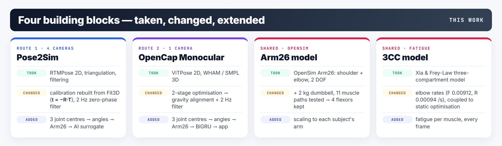</p>

| Building block | Taken | Changed | Added on top |
|---|---|---|---|
| **[Pose2Sim](https://github.com/perfanalytics/pose2sim)** (route 1, 4 cameras) | RTMPose 2D pose, multi-view triangulation, Butterworth filtering | calibration rebuilt from the Fit3D parameters with `t = −R·T`; single-person, lightweight configuration | 3 joint centres → 2 joint angles → scaled Arm26 → LightGBM surrogate |
| **[OpenCap Monocular](https://arxiv.org/abs/2603.24733)** (route 2, 1 camera) | ViTPose 2D pose, WHAM / SMPL 3D estimate | its two-stage optimisation replaced by a gravity alignment and a 2 Hz filter; shoulder centre blended from two regressors | 3 joint centres → 2 joint angles → scaled Arm26 → BiGRU surrogate → application |
| **OpenSim Arm26** (shared) | the 2-DOF arm model: shoulder elevation + elbow flexion | a 2 kg dumbbell welded to the hand; 11 muscle paths tested, 4 flexors kept; brachioradialis path corrected | scaling to each subject's measured arm |
| **3CC fatigue** (Xia & Frey-Law, 2008) (shared) | the three-compartment model: resting → active → fatigued | elbow rates (F = 0.00912 /s, R = 0.00094 /s); coupled to static optimisation | a fatigue state for each of the 4 flexors, every frame |

The two routes are the two ways in. **Route 1** is the accurate reference (4 calibrated cameras).
**Route 2** is the one a patient can use at home (1 ordinary video), and the one the application runs.

---

## 🧩 My contribution — how each tool was read, and what was added

### 1 · Pose2Sim → the multi-camera route

**How Pose2Sim works.** Pose2Sim is driven by a project folder (`calibration/`, `videos/`,
`Config.toml`) and one function per stage:
`calibration → poseEstimation → synchronization → personAssociation → triangulation → filtering → markerAugmentation → kinematics`.
Its last two stages turn the body into an augmented marker set and solve a full-body OpenSim
inverse kinematics.

**What I used, and how** ([`src/pipeline/batch_all_subjects.py`](src/pipeline/batch_all_subjects.py)):

| Pose2Sim stage | Used? | How it is used here |
|---|:---:|---|
| `calibration` | replaced | Fit3D already provides intrinsics and extrinsics, so `setup()` writes Pose2Sim's `Calib.toml` directly: `K` from the focal lengths and principal point, distortions `[k1, k2, p1, p2]`, rotation as a Rodrigues vector, and **translation = −R·T** (Pose2Sim expects the OpenCV extrinsic, not the camera centre). This one fix took the elbow-angle correlation from about 0.86 to **0.99**. |
| `poseEstimation` | ✅ | RTMPose, `pose_model = Body_with_feet` (HALPE-26), `mode = lightweight`, `det_frequency = 4`, `multi_person = false` |
| `synchronization`, `personAssociation` | — | not needed: Fit3D views are synchronized and contain one person |
| `triangulation` | ✅ | `min_cameras_for_triangulation = 2`, `reproj_error_threshold_triangulation = 30`, `likelihood_threshold_triangulation = 0.3`, `interp_if_gap_smaller_than = 30` |
| `filtering` | ✅ | Pose2Sim's Butterworth; its `*_filt_butterworth.trc` feeds scaling and learning. A **2 Hz zero-phase Butterworth** (`filtfilt`) is added before any differentiation, so accelerations are clean enough for inverse dynamics |
| `markerAugmentation`, `kinematics` | ❌ | replaced by the arm layers below — a curl moves one joint, a full-body model would ask for kinematics the task does not need |

**What I added on top:**

1. **Three joint centres** read from the `.trc` (`RShoulder`, `RElbow`, `RWrist`), and the two Arm26
   coordinates computed analytically: elbow flexion `180° − ∠(S−E, W−E)` and shoulder elevation as
   the angle of the upper arm to the vertical. Written as an OpenSim motion (`.mot`).
2. **Validation against Vicon** for every subject: the same angles computed from Fit3D's
   `joints3d_25`, aligned by a 0–7-frame lag search and a linear calibration (`best_affine`), then
   correlation and MAE.
3. **Subject scaling** from the median segment lengths ([`scale_from_trc.py`](src/pipeline/scale_from_trc.py)).
4. **The OpenSim stage** — ID, SO, 3CC ([`run_stage2_pipeline.py`](src/pipeline/run_stage2_pipeline.py),
   [`run_id_so.py`](src/pipeline/run_id_so.py), [`run_fatigue_so.py`](src/pipeline/run_fatigue_so.py)).
5. **Three LightGBM surrogates** plugged in at three depths of the pipeline ([`src/ml/`](src/ml)).

### 2 · OpenCap Monocular → the single-camera route

**How OpenCap Monocular works.** With one camera there is nothing to triangulate, so a network
*guesses* the 3D pose and an optimisation *repairs* the guess before OpenSim reads it:
`video → ViTPose (2D + confidence) → WHAM / SMPL (initial 3D) → 2-stage optimisation (camera and shape, then pose, feet and floor) → 38 virtual markers → OpenSim Scale + IK, 33 DOF → kinematics → ground-reaction kinetics`.

**Reading it against our task.** The second optimisation stage is dominated by foot-contact, foot-slide
and floor terms; the 38 markers exist to constrain 33 degrees of freedom; the kinetics are ground
reaction forces for walking. A seated, loaded elbow flexion has no foot contact, needs two degrees of
freedom, and wants muscle-level outputs that OpenCap Monocular does not produce. So the fork is right
after WHAM.

| OpenCap Monocular stage | Kept? | What replaces it |
|---|:---:|---|
| One static camera, no calibration | ✅ | one Fit3D view used as the only camera (16 runs over 8 subjects) |
| ViTPose 2D keypoints | ✅ | unchanged |
| WHAM / SMPL initial 3D | ✅ | unchanged, read from `wham_output.pkl`; **shoulder centre = mean of WHAM's COCO and H36M regressors**, which misplace the shoulder in opposite directions |
| Two-stage optimisation | ❌ | **gravity alignment**: the mean torso-up vector (mid-shoulder − mid-hip) is rotated onto +Y, so shoulder elevation reads directly from the upper arm; then a **2 Hz zero-phase Butterworth** removes jitter before differentiation |
| 38 virtual markers | ❌ | **3 joint centres** — shoulder, elbow, wrist |
| Scale + IK, 33 DOF | ❌ | **analytical** shoulder and elbow angles, and a scaled **2-DOF Arm26** |
| Kinematics → GRF kinetics | ❌ | Inverse Dynamics → Static Optimization → **3CC fatigue** |
| — | ➕ | a **BiGRU** surrogate at three entry levels, and a patient / clinician **application** |

The lighter correction has a measured cost: OpenCap Monocular reports 4.8° rotational error, this
route measures 6.94° at the elbow — still inside the 10° limit fixed before testing.

### 3 · OpenSim Arm26 → the loaded arm

<p align="center">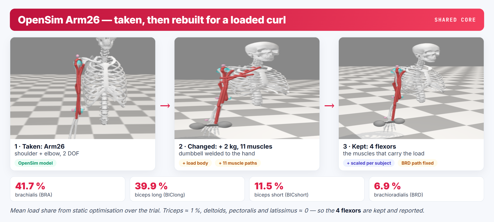</p>

- **Taken:** Arm26, the smallest OpenSim model that still contains the mechanics of a curl
  (shoulder elevation + elbow flexion). Full-body models would need trunk and leg kinematics a camera
  cannot constrain, and many unused muscles inside the optimisation.
- **Changed:** a **2 kg** body (`load_2kg`) welded to the hand with a `WeldJoint`
  ([`build_arm26_model.py`](src/pipeline/build_arm26_model.py)) — mass only, so gravity acts on it
  through the same dynamics as the limb. The muscle set was **enriched to 11 paths**, then filtered by
  experiment: static optimisation shows the load is carried by the four elbow flexors — BRA 41.7 %,
  BIClong 39.9 %, BICshort 11.5 %, BRD 6.9 % — while the triceps stay near 1 % and the deltoids,
  pectoralis and latissimus at 0. **The four flexors are kept and reported.** The brachioradialis path
  was corrected until its peak elbow moment arm reached 7.51 cm near 114°.
- **Added:** scaling to each subject's humerus and forearm, so forces are subject-specific.

### 4 · The 3CC fatigue model → fatigue per muscle

<p align="center">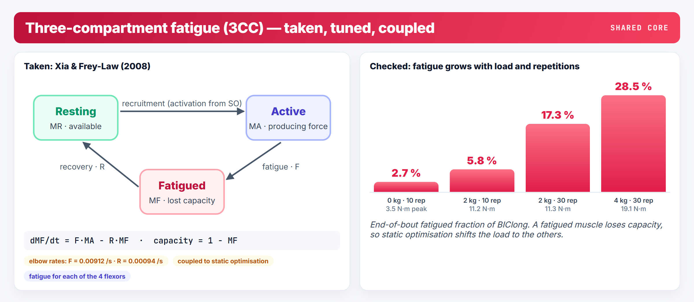</p>

- **Taken:** the three-compartment model of Xia & Frey-Law (2008): motor units move between
  *resting*, *active* and *fatigued*, `dMF/dt = F·MA − R·MF`, `capacity = 1 − MF`.
- **Changed:** elbow rates from Frey-Law et al. (2012), **F = 0.00912 /s, R = 0.00094 /s**, and the
  model is **coupled to static optimisation** ([`run_fatigue_so.py`](src/pipeline/run_fatigue_so.py)):
  each frame, a muscle cannot exceed its fatigued capacity, so the load shifts to the others, which
  raises their activation and in turn their fatigue. If the flexors together cannot meet the demand,
  task failure is flagged.
- **Checked:** the fatigued fraction of BIClong grows with load and repetitions — 2.7 % (0 kg ·
  10 rep), 5.8 % (2 kg · 10), 17.3 % (2 kg · 30), 28.5 % (4 kg · 30).

---

## 🎥 Route 1 — Multi-camera, built on Pose2Sim

<p align="center">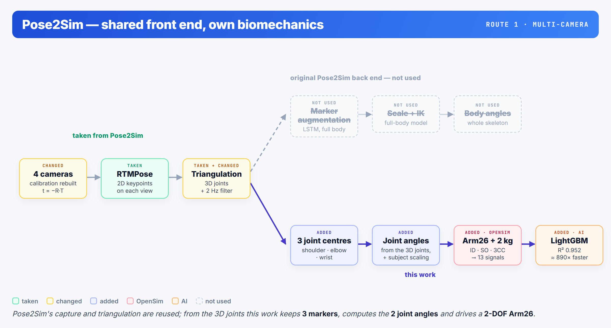</p>

<p align="center">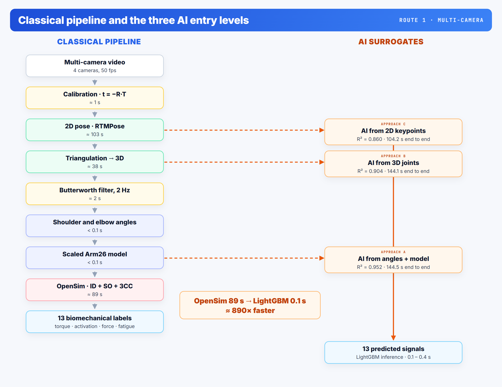</p>

### Blender check

<p align="center"><a href="media/blender.mp4">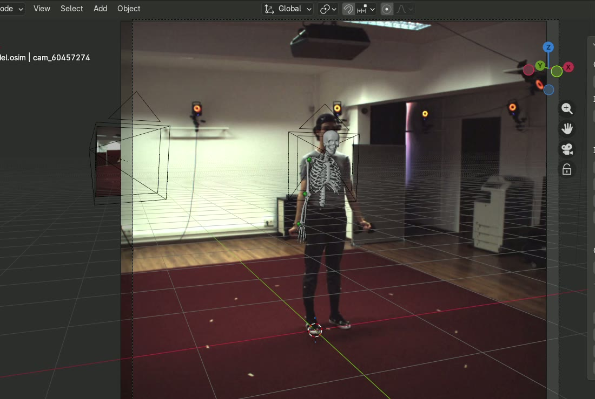</a></p>

The scaled model and its motion are loaded into Blender with the four calibrated cameras and the
skeleton is laid over each original view. If the calibration, the triangulation or the angles were
wrong, the skeleton would slide off the person. ▶ [`media/blender.mp4`](media/blender.mp4)

### Validation against Vicon

| Test | Metric | Result |
|---|---|---|
| 1 · 2D pose | reprojection error | **8.3 px** |
| 2 · 3D reconstruction | distance / direction to Vicon | **27.8 mm / 5.5°** |
| 3 · Joint angles | elbow correlation / MAE | **0.99 / 4.2°** |
| 4 · Subject scaling | segment scale factors | **×0.85 – ×1.05** |

### AI surrogate

| Approach | Input | mean R² | torque | activation | force | fatigue | End to end | AI inference |
|----------|-------|:---:|:---:|:---:|:---:|:---:|:---:|:---:|
| **A — `.mot + .osim`** | angles + scaled model | **0.952** | 0.937 | 0.962 | 0.964 | 0.936 | 144.5 s | 0.36 s |
| **B — 3D joints** | 3 triangulated joints | **0.904** | 0.827 | 0.922 | 0.916 | 0.893 | 144.1 s | 0.10 s |
| **C — 2D keypoints** | raw 2D, 4 cameras | **0.860** | 0.782 | 0.873 | 0.881 | 0.845 | 104.2 s | 0.17 s |

Leave-one-subject-out over 8 subjects. OpenSim takes about 89 s per subject, the surrogate 0.1 s
(**≈ 890×**), from one 21 MB file.

**Models compared**

<p align="center">
  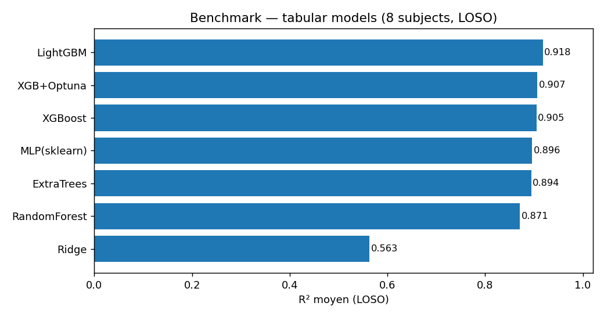
  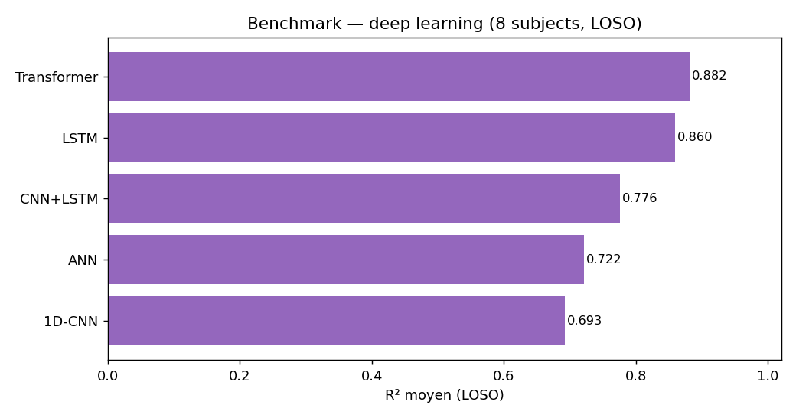
</p>

| Model | Input | mean R² |
|---|---|:---:|
| **LightGBM + feature engineering + Optuna** | cleaned angles + anthropometry | **0.952** |
| Transformer (TST) | engineered features | 0.882 |
| XGBoost / LightGBM + features | 3D joints + rolling statistics | 0.867 |
| LSTM | engineered features | 0.860 |
| LightGBM (basic) | 3D joints | 0.842 |
| TST (vanilla) · PatchTST · iTransformer · TFT-lite | raw 3D windows | 0.805 · 0.792 · 0.772 · 0.657 |

<p align="center">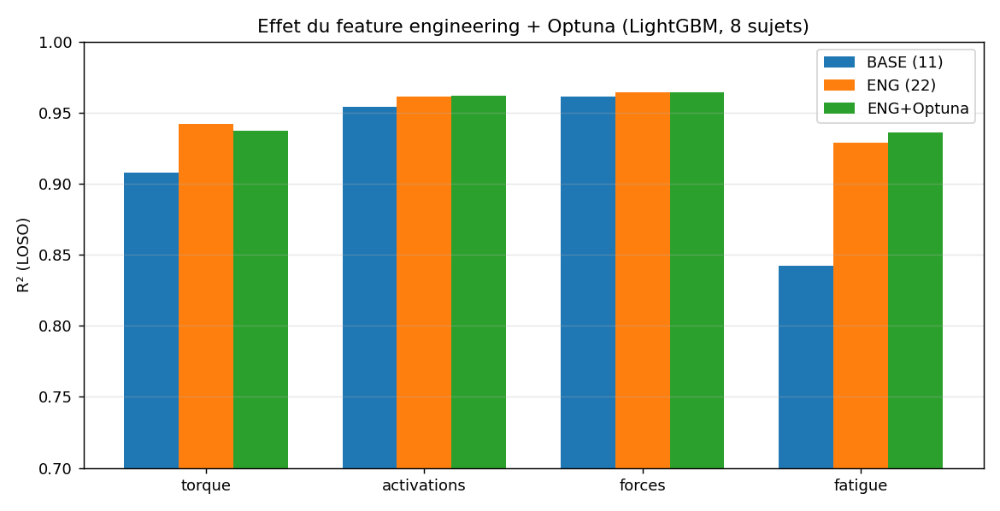</p>

**Curves — the surrogate against OpenSim, held-out subject**

<p align="center">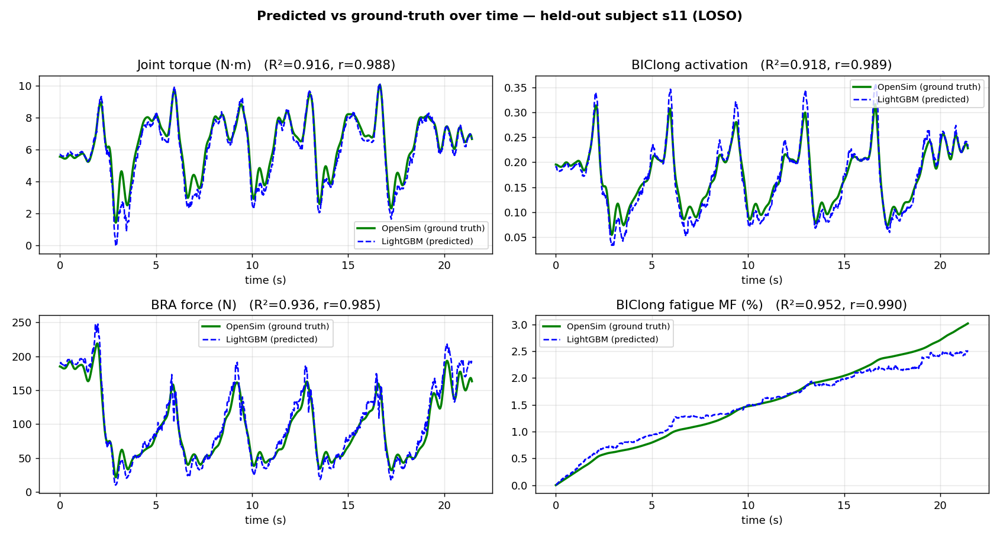</p>
<p align="center">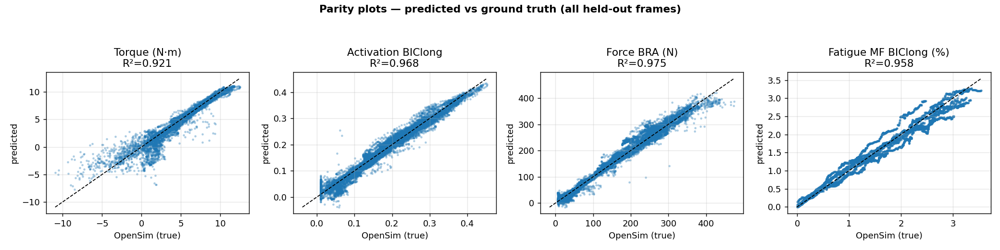</p>
<p align="center">
  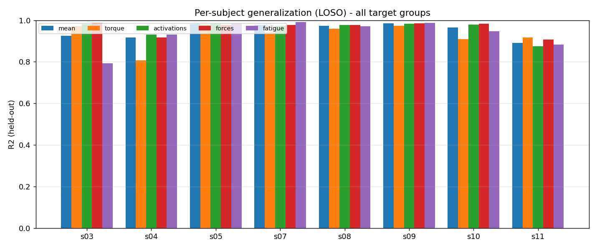
  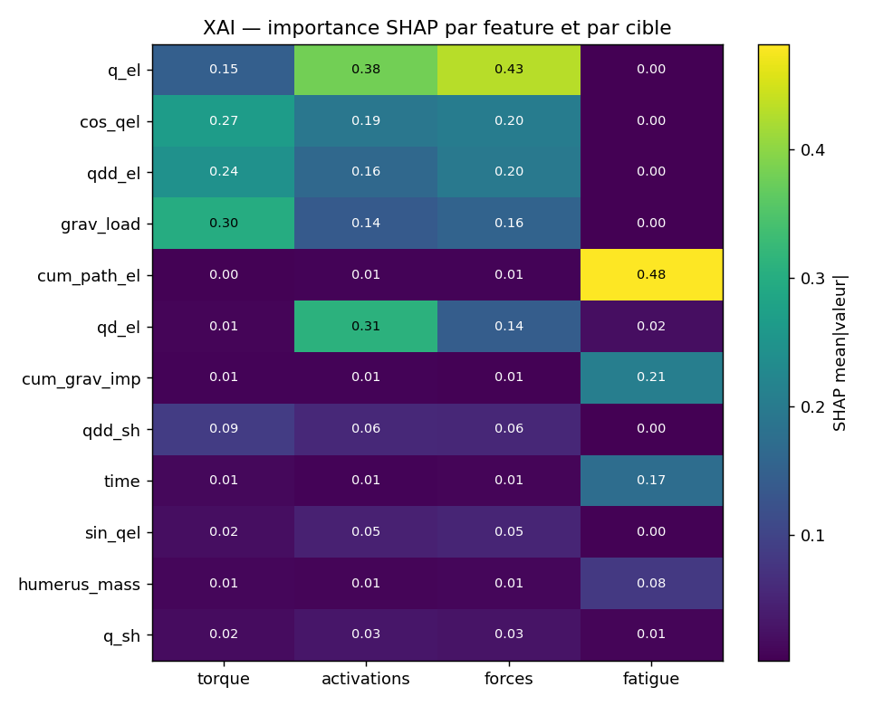
</p>

---

## 📱 Route 2 — Single camera, built on OpenCap Monocular

<p align="center">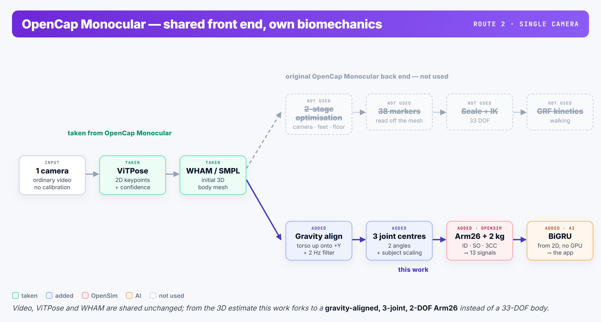</p>

### Validation against Vicon — four tests, thresholds fixed beforehand

| Test | Metric | Result | Limit | Verdict |
|---|---|---|---|:---:|
| 1 · 2D pose (ViTPose) | median reprojection | **7.7 px** | < 15 px | pass |
| 2 · 3D reconstruction | RMSE / direction | **49.4 mm / 6.6°** | < 60 mm / 8° | pass |
| 3 · Joint angles | elbow r / MAE | **0.993 / 6.94°** | > 0.90 / 10° | pass |
| 4 · Subject scaling | humerus / forearm | **×0.943 / ×1.017** | 0.85 – 1.15 | pass |

8 subjects, 16 single-camera runs; every test passes on every subject.

<p align="center">
  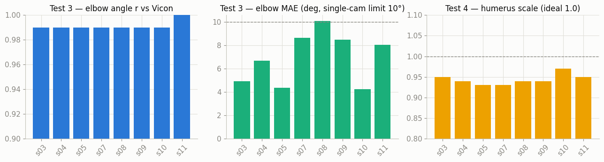
  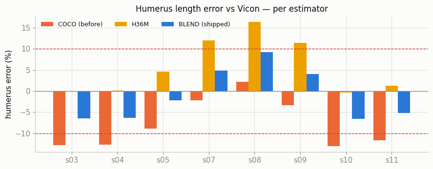
</p>

### From a validated pipeline to a training corpus

Once validated, the pipeline labels any ordinary video with the 13 signals. MM-Fit (21 subjects, no
reference) is added for learning only: **37 runs, 29 subjects, 25 615 frames**. No accuracy claim is
drawn from MM-Fit.

### The three AI entry levels

<p align="center">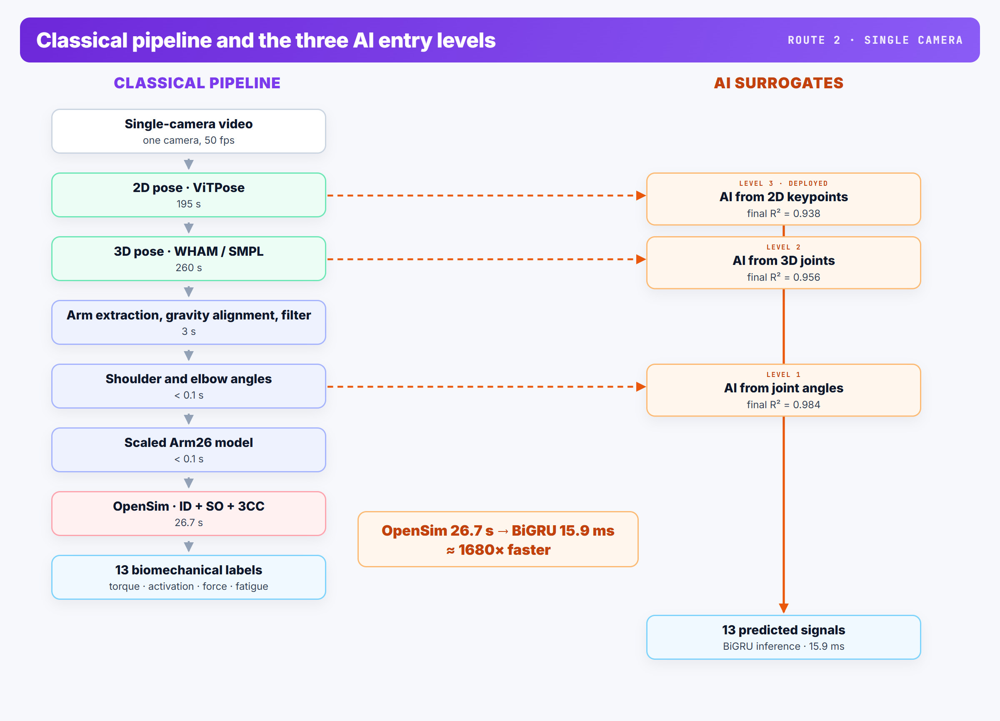</p>

| Level | Input | final R² | Time per trial | GPU |
|---|---|:---:|:---:|:---:|
| **L1** | joint angles | **0.984** | 458 s | yes |
| **L2** | 3D joints | **0.956** | 455 s | yes |
| **L3 — deployed** | 2D keypoints | **0.938** | 195 s | **no** |

One 35 s recording costs **485 s** through the full pipeline (ViTPose 195 s, WHAM 260 s, OpenSim
26.7 s). The OpenSim solve becomes a 15.9 ms forward pass (**≈ 1680×**), but only Level 3 starts
early enough to remove WHAM — more than half the pipeline — and the GPU. Evaluation is grouped on the
subject: no frame of a test subject is seen in training.

**Why Level 3 is the one deployed:** 195 s per trial instead of 458 s, and it runs on a CPU with no
GPU, for only 0.046 less R² than Level 1 (0.938 against 0.984).

**Models compared — best R² per level**

| Architecture | Level 1 | Level 2 | Level 3 |
|---|:---:|:---:|:---:|
| **BiGRU** | **0.9842** | **0.9556** | **0.9376** |
| Transformer | 0.9815 | 0.9493 | 0.9266 |
| Informer | 0.9814 | 0.9471 | 0.9196 |
| FEDformer | 0.9799 | 0.9446 | 0.9174 |
| TFT-lite | 0.9738 | 0.9019 | 0.8604 |
| Crossformer | 0.9553 | 0.8962 | 0.8535 |
| PatchTST | 0.9440 | 0.8898 | 0.8413 |
| iTransformer | 0.8897 | 0.8809 | 0.8403 |
| *Final, 5-fold* | *0.984* | *0.956* | *0.938* |

**Curves — Level 3, the deployed model, held-out subject**

<p align="center">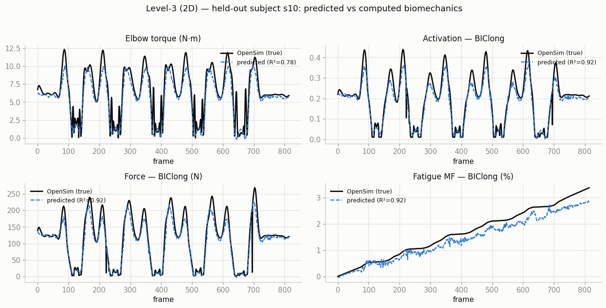</p>
<p align="center">
  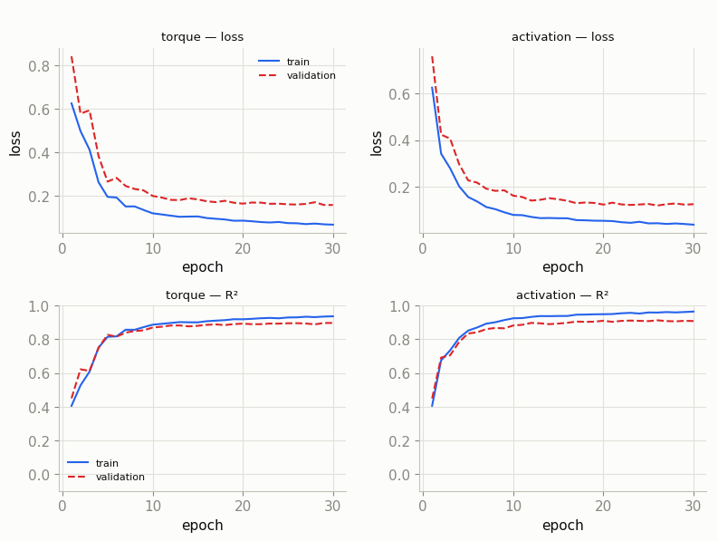
  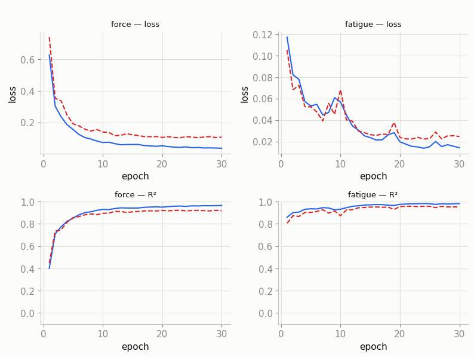
</p>

Levels 1 and 2: [`pred_L1.png`](figures/singlecam/pred_L1.png) · [`pred_L2.png`](figures/singlecam/pred_L2.png).

### The application

<p align="center"><a href="media/app.mp4">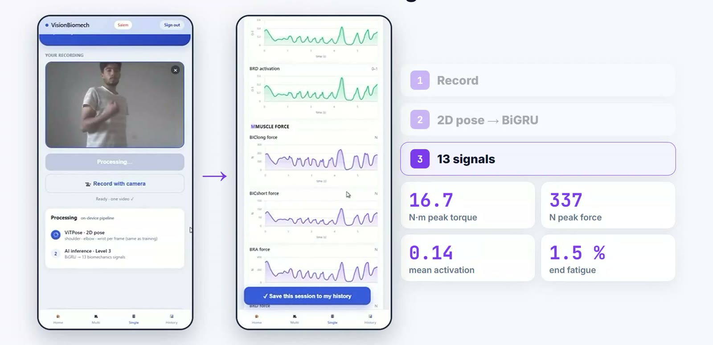</a></p>

1. The **clinician** prescribes an exercise from a web dashboard.
2. The **patient** records one set with an ordinary camera, at home.
3. The **analysis service** extracts 2D keypoints (RTMPose-s, on the CPU) and runs the Level-3 BiGRU:
   the 13 signals come back.
4. The **clinician** reviews the saved session — video and signals — and adjusts the prescription.

**Reading the result: effort in the video → peak in the signal.**

<p align="center">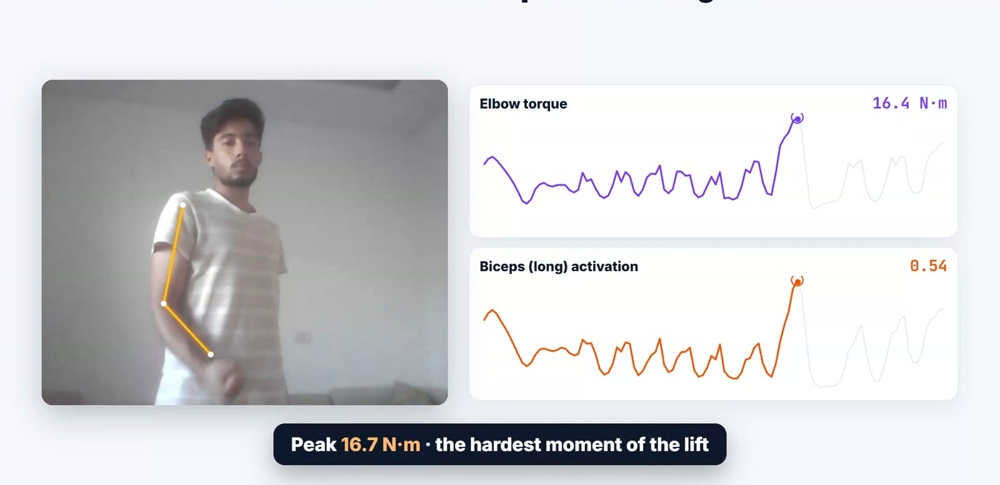</p>

In the recorded session the elbow torque peaks at **16.7 N·m** and the biceps (long head) activation
at **0.55** at the same instant — the moment of the set where the arm is lifted hardest. The torque
the elbow has to produce grows when the load is accelerated upward and as the forearm nears the
horizontal, where the load's lever arm about the elbow is longest; the hardest moment of the lift is
therefore where the curves peak, and the clinician can find it at a glance.

---

## ⚖️ Side by side

| | Multi-camera · Pose2Sim | Single camera · OpenCap Monocular |
|---|---|---|
| What you need | 4 calibrated, synchronized cameras | 1 ordinary video |
| 3D error against Vicon | **27.8 mm** | **49.4 mm** |
| Elbow angle | **4.2°** MAE · r = 0.99 | **6.94°** MAE · r = 0.993 |
| AI surrogate | LightGBM · R² **0.952** | BiGRU · R² **0.984**, **0.938** from 2D alone |
| Solver replaced | 89 s → 0.1 s · **≈ 890×** | 26.7 s → 15.9 ms · **≈ 1680×** |
| Subjects | 8 (Fit3D), leave-one-subject-out | 29 (Fit3D + MM-Fit), subject-grouped folds |
| Role | the accurate reference | shipped in the application, no GPU |

---

## 📊 Datasets

| Dataset | What it gives | How it is used |
|---|---|---|
| **[Fit3D](https://fit3d.imar.ro/fit3d)** — `dumbbell_biceps_curls`, 8 subjects | 4 synchronized calibrated cameras at 50 fps, camera parameters, **Vicon 3D joints** | route 1 (4 views), route 2 (each view alone), every validation |
| **[MM-Fit](https://zenodo.org/records/7607736)** — 21 subjects | uncalibrated video, no motion capture | route 2 learning only |

> Fit3D and MM-Fit media are **not** redistributed here; only lightweight derived data is committed.

---

## 📂 Repository structure

```
.
├── src/
│   ├── pipeline/              # Route 1: vision → biomechanics
│   │   ├── batch_all_subjects.py    #   Fit3D → Calib.toml (t = −R·T) → Pose2Sim → metrics vs Vicon
│   │   ├── run_stage2_pipeline.py   #   3D .trc → Arm26 → ID / SO / 3CC
│   │   ├── build_arm26_model.py     #   Arm26 + 2 kg dumbbell (WeldJoint)
│   │   ├── scale_from_trc.py        #   subject-specific scaling
│   │   ├── run_id_so.py · run_fatigue_so.py   # ID + SO, 3CC coupled to SO
│   │   └── batch_calib_all.py · build_calib_world.py · extract_labels_all.py
│   ├── ml/                   # Route 1 surrogates: approaches A / B / C + benchmarks
│   └── viz/                  # figures, timing, memory
├── models/                    # LightGBM surrogates (A / B / C) + the Arm26 model
├── dataset/                   # route 1 ML datasets + metrics
├── figures/
│   ├── diagrams/              # building blocks, the two forks, the AI entry levels, Arm26, 3CC
│   ├── singlecam/             # route 2: validation, training curves, predictions
│   └── app/                   # application screens, peak = effort
└── media/                     # demo.mp4 · app.mp4 · blender.mp4 · banner.gif
```

## 🚀 Reproduce (route 1)

```bash
conda create -n biomech python=3.10 && conda activate biomech
pip install opensim pose2sim lightgbm optuna shap scikit-learn pandas matplotlib
# download the Fit3D videos -> https://fit3d.imar.ro/fit3d
python src/pipeline/batch_all_subjects.py        # Pose2Sim + validation against Vicon
python src/pipeline/run_stage2_pipeline.py       # Arm26: ID / SO / 3CC labels
python src/pipeline/extract_labels_all.py
python src/ml/train_approach_B_3d.py             # a surrogate (approach B)
python src/ml/benchmarks_tabular.py
```

```python
import joblib
m = joblib.load("models/approach_B_3d/lgbm_3d_vision.joblib")
y = m["y_scaler"].inverse_transform(m["model"].predict(m["x_scaler"].transform(X)))
# y -> [elbow torque, 4× activation, 4× force, 4× fatigue]
```

## 📦 What is and isn't in the repo

**Included** — route 1 code (`src/`), its surrogates and the Arm26 model (`models/`), its datasets and
metrics (`dataset/`), the figures of both routes (`figures/`) and the videos (`media/`).

**Not included** — raw videos and per-frame keypoints (regenerated from Fit3D), OpenSim `Geometry/`
meshes, and for route 2 the training notebooks, the BiGRU checkpoints and the application source:
that route is documented here by its method, results and figures.

## 🛠️ Tech stack

**Vision** Pose2Sim · RTMPose · ViTPose · WHAM / SMPL &nbsp;|&nbsp;
**Biomechanics** OpenSim · Arm26 · Inverse Dynamics · Static Optimization · 3CC fatigue &nbsp;|&nbsp;
**ML** LightGBM · BiGRU (PyTorch) · Optuna · SHAP · scikit-learn &nbsp;|&nbsp;
**Application** FastAPI · SQLite · progressive web app

---

Built on **Fit3D**, **MM-Fit**, **Pose2Sim**, **OpenCap Monocular**, **WHAM**, **ViTPose** and **OpenSim**.

**Author** — Idriss Abderraouf Jedid
