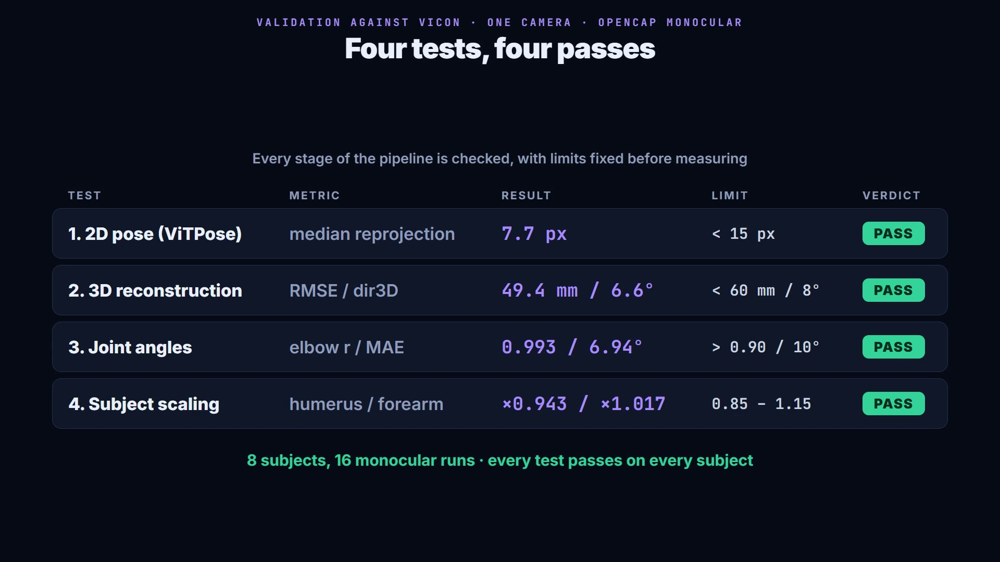
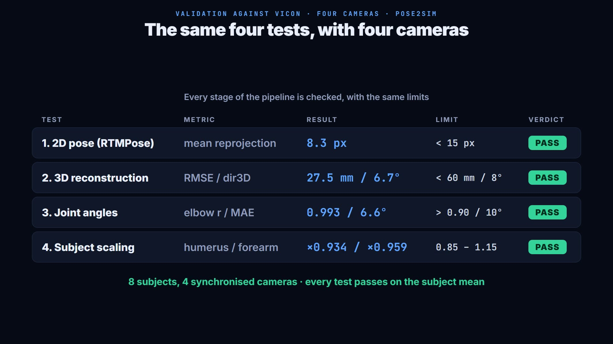
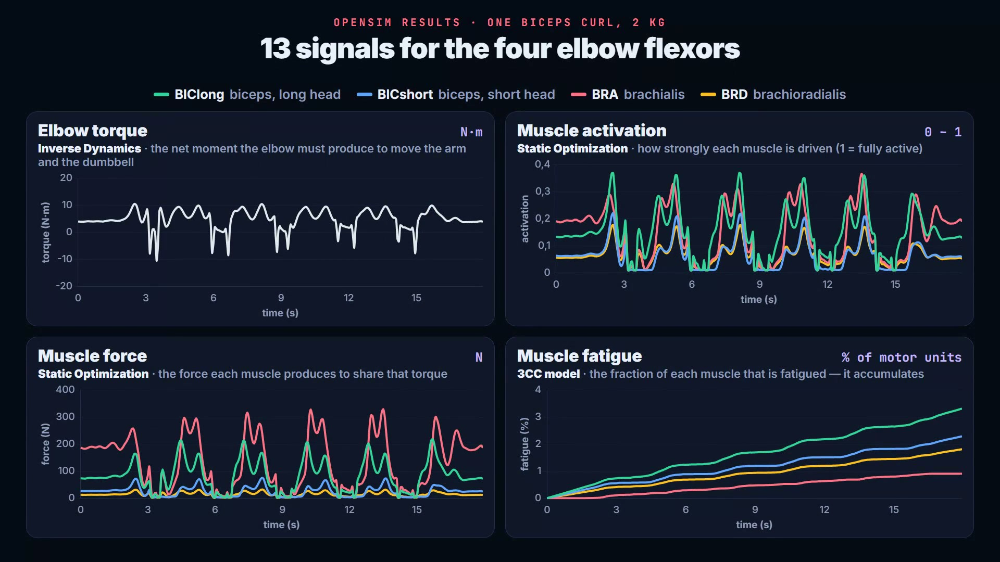
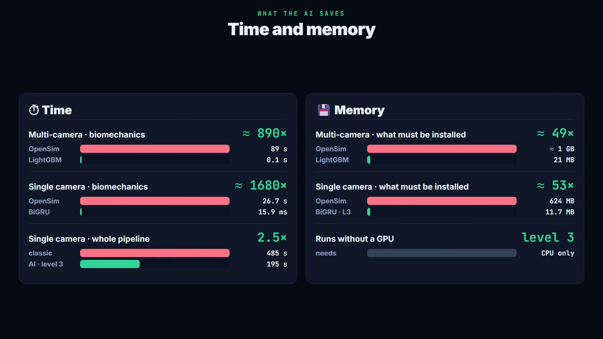
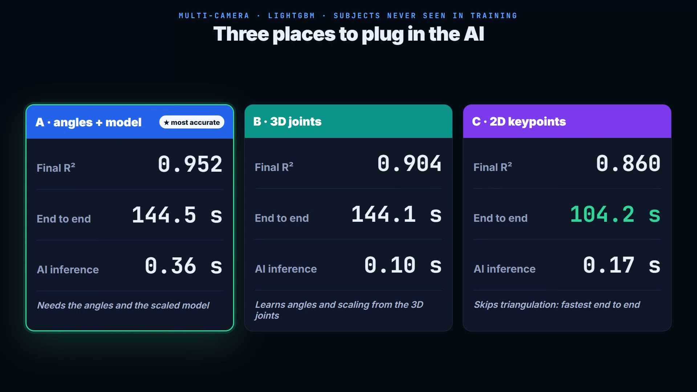
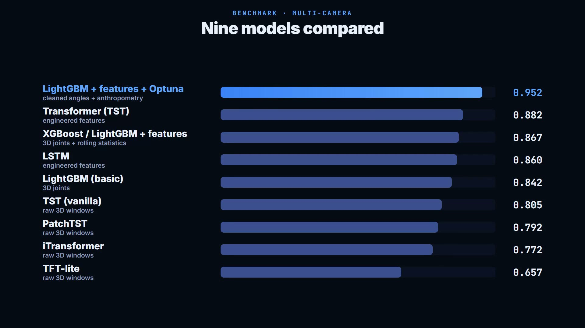
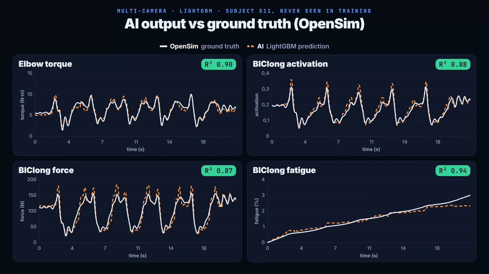
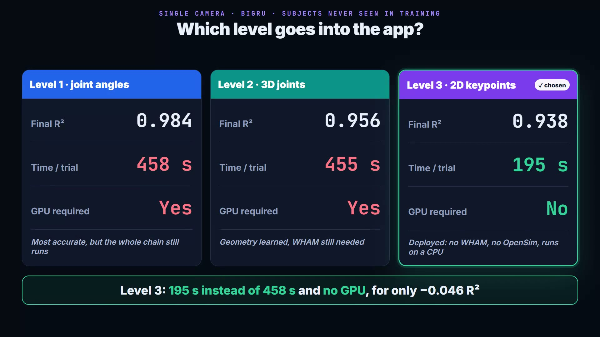
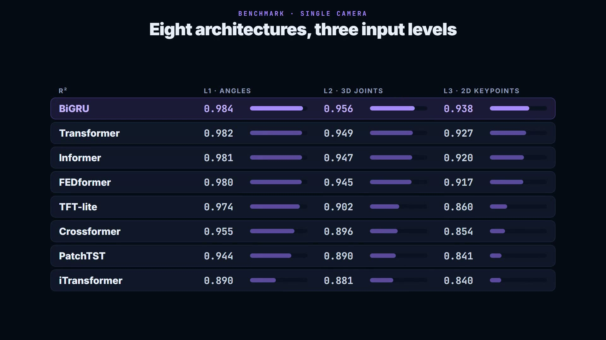
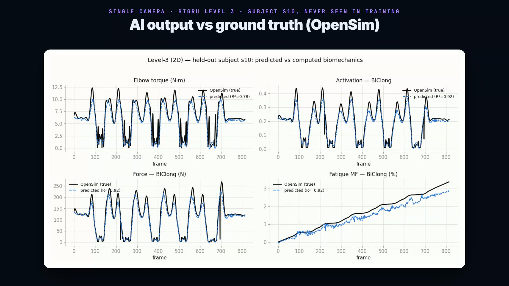

<h1 align="center">Vision-Based Optical Simulation</h1>
<h3 align="center">Upper-limb muscle forces and fatigue from markerless video</h3>

  <b><a href="https://idriss-jedid.github.io/Vision-Based-Optical-Simulation-for-Muscle-Fatigue-and-Biomechanical-Variable-Prediction/">Project page</a></b>
  &nbsp;·&nbsp; <a href="media/demo.mp4">Narrated demo</a>
  &nbsp;·&nbsp; <a href="https://fit3d.imar.ro/fit3d">Fit3D</a>
  &nbsp;·&nbsp; <a href="https://zenodo.org/records/7607736">MM-Fit</a>

  <video src="https://idriss-jedid.github.io/Vision-Based-Optical-Simulation-for-Muscle-Fatigue-and-Biomechanical-Variable-Prediction/demo.mp4" controls width="860" poster="media/banner.gif"></video>

## Abstract

Muscle activation, force and fatigue are central to rehabilitation, yet they are usually measured
with electromyography, force sensors or marker-based motion capture: equipment that is costly,
intrusive and confined to the laboratory. An ordinary RGB camera, by contrast, is available
everywhere, but it only records how a limb moves, not how its muscles work.

This work presents a vision-based framework that estimates the internal biomechanics of the upper
limb from markerless RGB video, demonstrated on the dumbbell biceps curl. Two routes recover the
motion of the arm. The multi-camera route extends Pose2Sim: RTMPose detects 2D keypoints in four
calibrated views, which are triangulated into 3D joints. The single-camera route extends OpenCap
Monocular: ViTPose and WHAM estimate the 3D body from a single video, which is then aligned with
gravity and filtered. In both routes, the shoulder, elbow and wrist give the two joint angles of the
arm. Validated against Vicon motion capture, the elbow angle follows the reference with a correlation of
0.993 in both routes, with a mean error of 6.6° with four cameras and 6.94° with one camera.

The recovered motion drives a subject-scaled OpenSim Arm26 musculoskeletal model carrying a 2 kg
dumbbell. Inverse dynamics, static optimisation and a three-compartment fatigue model produce
thirteen time-resolved signals: the elbow torque and the activation, force and fatigue of the four
elbow flexors (biceps long and short heads, brachialis and brachioradialis).

Because this physics-based pipeline takes several minutes per recording, machine-learning surrogates
are trained to reproduce its outputs directly. With four cameras, LightGBM reaches R² = 0.952
against OpenSim. With a single camera, a bidirectional GRU predicts the thirteen signals from 2D
keypoints alone with R² = 0.938 on unseen subjects, about 1,680 times faster than the OpenSim solve
and without a GPU.

This model is integrated into a web and mobile application: the patient records an exercise at home
with a phone camera, and the clinician reviews the resulting muscle signals remotely. The framework
offers a low-cost, non-contact way to monitor muscle effort and fatigue in rehabilitation. Data are
drawn from the Fit3D and MM-Fit datasets.

**Keywords:** RGB camera · markerless motion capture · human pose estimation · 3D reconstruction · musculoskeletal modelling · OpenSim · muscle activation · muscle force · muscle fatigue · surrogate model · deep learning · tele-rehabilitation

---

## Contents

1. [Overview](#1-overview)
2. [Building the two pipelines](#2-building-the-two-pipelines)
3. [Validation against Vicon](#3-validation-against-vicon)
4. [Biomechanical outputs](#4-biomechanical-outputs)
5. [Why an AI surrogate](#5-why-an-ai-surrogate)
6. [AI surrogate: approaches, benchmark and prediction](#6-ai-surrogate-approaches-benchmark-and-prediction)
7. [Optimisation, ONNX export and deployment](#7-optimisation-onnx-export-and-deployment)
8. [Datasets](#8-datasets)

---

## 1. Overview

Two pipelines take a video of a biceps curl all the way to the muscle signals, one with **four
cameras** and one with a **single camera**. Neither was built from scratch: both start from an
existing open-source architecture, which was adapted to the upper limb and extended with new layers.

| Step | What was done |
|---|---|
| **Architectures** | took Pose2Sim (4 cameras) and OpenCap Monocular (1 camera), and changed them for an arm task |
| **Musculoskeletal model** | took OpenSim Arm26, and changed it for a loaded curl |
| **Validation** | tested each stage of both pipelines against Vicon motion capture |
| **Outputs** | extracted elbow torque and muscle activation, force and fatigue (3CC) |
| **AI** | replaced the slow pipeline with a learned surrogate: 3 input approaches, model benchmark, fine-tuning |
| **Deployment** | optimised the chosen model, exported it to ONNX, and deployed it in a web and mobile app |

The figure below summarises the whole project in four building blocks: the two vision routes
(Pose2Sim and OpenCap Monocular) and the two shared components (the Arm26 musculoskeletal model and the
3CC fatigue model). Each card reads from top to bottom: in green, what was **taken** unchanged from
the original work; in orange, what was **changed** to fit an arm exercise; in blue, what was **added**
by this work. The point of the figure is that the project reuses proven tools where they work and
rebuilds only the parts that were designed for something else, such as walking or the full body.

---

## 2. Building the two pipelines

### 2.1 Four cameras — from Pose2Sim

Pose2Sim's 2D pose estimation (RTMPose), triangulation and filtering are kept. Its calibration is
replaced by a conversion of the Fit3D camera parameters, where the translation must be `−R·T`; this
fix alone raised the elbow-angle correlation from 0.86 to 0.99. Its full-body marker augmentation and
inverse kinematics are replaced by three joint centres (shoulder, elbow, wrist) and two analytical
joint angles.

How to read the diagram: the chain starts on the left with the four cameras. The boxes on the first
row are the front end taken from Pose2Sim: the four cameras (with the calibration rebuilt), RTMPose
keypoints in every view, and triangulation into 3D joints with a 2 Hz filter. The greyed, dashed boxes at the top are Pose2Sim's
original full-body back end, which is **not used** here. Instead, the purple arrow leads to the back
end built in this work (bottom row): three joint centres, the two joint angles with subject scaling,
the Arm26 model with a 2 kg dumbbell that produces the 13 signals, and finally the LightGBM surrogate
that replaces OpenSim.

### 2.2 One camera — from OpenCap Monocular

OpenCap Monocular's ViTPose and WHAM stages are kept. Its two-stage optimisation, designed for walking
(feet, floor, ground contact), is replaced by aligning the torso with gravity and a zero-phase 2 Hz
filter; its 38 markers and 33-DOF body by three joint centres and a 2-DOF arm. The shoulder centre is
taken between WHAM's two joint regressors, which err in opposite directions.

The diagram has the same layout as the previous one. On the left, an ordinary uncalibrated video goes
through ViTPose (2D keypoints with a confidence per joint) and WHAM (a first 3D body mesh); these two
stages come unchanged from OpenCap Monocular. The greyed boxes at the top are the original back end,
built for gait analysis (camera, feet and floor optimisation, 38 markers, a 33-DOF body and ground
reaction forces), which an arm exercise does not need. The bottom row is this work: gravity
alignment, three joint centres and two angles, the Arm26 model with the dumbbell, and the BiGRU that
runs in the application without a GPU.

### 2.3 Musculoskeletal model — from OpenSim Arm26

The 2-DOF Arm26 model receives a 2 kg dumbbell welded to the hand and is scaled to each subject.
Eleven muscle paths were tested; static optimisation shows that four flexors carry the load
(brachialis 41.7 %, biceps long head 39.9 %, short head 11.5 %, brachioradialis 6.9 %), so these four
are kept.

The figure follows the model in three steps, from left to right: (1) the original Arm26, a shoulder
and an elbow with two degrees of freedom; (2) the model changed for the exercise, with the dumbbell
attached to the hand and eleven candidate muscle paths; (3) the final model, which keeps only the four
elbow flexors and is scaled to each subject's arm. The four numbers at the bottom are the share of the
load that each flexor carries during the curl: together they account for almost all of it, while the
triceps, deltoids, pectoralis and latissimus contribute close to nothing. That is why only these four
muscles are reported in the rest of the work.

---

## 3. Validation against Vicon

Before any biomechanics is computed, each stage of both pipelines was tested on Fit3D (8 subjects)
against Vicon motion capture, the marker-based laboratory reference. Four tests follow the data
through the pipeline, and their limits were fixed before measuring:

1. **2D pose**: the Vicon joints are projected into each camera image and compared with the detected
   keypoints. A small error in pixels means both the calibration and the keypoint detector are right.
2. **3D reconstruction**: after a rigid alignment, the reconstructed shoulder, elbow and wrist are
   compared with Vicon in millimetres, together with the direction of each arm segment in degrees.
3. **Joint angles**: the elbow angle over the whole recording is compared with the Vicon angle, by
   its correlation (same shape) and its mean absolute error (same values).
4. **Subject scaling**: the upper-arm and forearm lengths measured from video are compared with the
   Arm26 defaults; the scale factors must stay in a physiological range.

With **one camera**, the keypoints land 7.7 px from the reference, the 3D joints 49.4 mm, and the elbow
angle follows Vicon with a correlation of 0.993 and an error of 6.94°. All four tests pass, on every
subject.

With **four cameras**, the same tests give 8.3 px in 2D and a tighter 3D error of 27.5 mm, since the
joints are triangulated instead of estimated from a single view. The elbow correlation is again 0.993,
and the segment scale factors stay close to 1. All four tests pass on the average over the subjects.

As a final visual check, the reconstructed skeleton is laid back over every camera view in Blender.
The image shows one of the four Fit3D cameras with the skeleton drawn in the same 3D scene as the
person. If the calibration or the triangulation were wrong, the skeleton would drift away from the
body; it stays on the arm throughout the movement. Click the image to watch the video.

---

## 4. Biomechanical outputs

From the validated motion, OpenSim computes the internal biomechanics frame by frame:

| Solver | Output |
|---|---|
| Inverse dynamics | elbow torque |
| Static optimisation | activation and force of the 4 flexors |
| Three-compartment fatigue model (3CC) | fatigue of the 4 flexors |

This gives **13 time-resolved signals** per recording. The figure below shows them for one biceps
curl with 2 kg. Top left, the **elbow torque** (N·m) is the net moment the elbow must produce to move
the arm and the dumbbell; each repetition appears as a wave. Top right, the **activation** of each
muscle (0 to 1) tells how strongly the nervous system drives it, and bottom left, the **force** (N)
is what each muscle produces to share that torque. The brachialis (red) and the long head of the
biceps (green) do most of the work, as the Arm26 analysis predicted. Bottom right, **fatigue** (% of
motor units) does not oscillate like the others: it accumulates with every repetition, which is
exactly what a camera alone could never show.

The fatigue signal comes from the three-compartment model of Xia and Frey-Law. On the left of the
figure, each muscle's motor units move between three states: **resting** (available), **active**
(producing force, recruited from the activation computed by static optimisation) and **fatigued**
(lost capacity, recovering slowly). The rates F and R were set for the elbow, and the model is
coupled to static optimisation, so a muscle that tires passes part of its load to the others. On the
right, the model is checked on four exercise conditions: the fatigue of the biceps long head grows
from 2.7 % with no load and 10 repetitions to 28.5 % with 4 kg and 30 repetitions, as expected.

---

## 5. Why an AI surrogate

The pipeline is accurate but heavy: on a single camera, one recording takes **485 s**, needs a
**GPU**, and depends on a full OpenSim installation. A clinical application cannot ask a patient to
wait minutes or to own a graphics card, so a learned model is trained to produce the same 13 signals
directly, without running OpenSim.

The figure summarises what this gains. On the left, **time**: with four cameras, the biomechanics
step drops from 89 s in OpenSim to 0.1 s with LightGBM (about 890×); with one camera, from 26.7 s to
15.9 ms with the BiGRU (about 1,680×); and the whole single-camera pipeline, from video to signals,
goes from 485 s to 195 s (2.5×). On the right, **memory**: what must be installed falls from about
1 GB to 21 MB with four cameras (about 49×), and from 624 MB to 11.7 MB with one camera (about 53×).
The deployed level 3 model runs on a CPU only.

---

## 6. AI surrogate: approaches, benchmark and prediction

The surrogate can start at three depths of the pipeline: **joint angles**, **3D joints** or **2D
keypoints**. The earlier it starts, the more computation it removes, but the less processed its
input is, so the harder the learning. Every model is evaluated on subjects never seen in training,
so the scores measure how well it generalises to a new person.

### 6.1 Four cameras — LightGBM

The diagram shows the multi-camera pipeline. On the left is the classical chain, with the time of
each stage: calibration, RTMPose, triangulation, the 2 Hz filter, the angles, the scaled model and
OpenSim. On the right are the three AI surrogates. Each orange dashed arrow shows where a surrogate
plugs in and which stages it skips: **approach C** starts from the 2D keypoints, **approach B** from
the 3D joints, and **approach A** from the angles and the scaled model. All three end in the same
13 predicted signals.

The three approaches compared. **A** (angles + model) is the most accurate, with R² = 0.952 against
OpenSim, because it receives clean angles and the subject's scaled anatomy. **B** (3D joints,
R² = 0.904) must learn the angles and the scaling by itself. **C** (2D keypoints, R² = 0.860) skips
triangulation altogether, which makes it the fastest end to end (104.2 s instead of about 144 s). In
every case the AI inference itself takes less than half a second.

To choose the model, nine candidates were compared, from gradient-boosted trees to recurrent networks
and transformers, each with its own input representation. The bars show the mean R² over the 13
signals. LightGBM with engineered features and Optuna tuning comes first (0.952), ahead of a time-series
transformer on the same features (0.882). Models that read raw 3D windows score lower (0.657 to
0.805): for this task, well-designed physical features matter more than model size.

The final test is a person the model has never seen (subject s11). Each panel overlays the OpenSim
ground truth (white) and the LightGBM prediction (orange, dashed) for one signal: the elbow torque,
and the activation, force and fatigue of the biceps long head. The predicted curves follow the
timing and the height of each repetition, and the fatigue curve keeps the slow upward trend; the R²
of each signal is given in the top right corner.

### 6.2 One camera — BiGRU

The same idea on the single-camera pipeline. On the left, the classical chain with its cost: ViTPose
195 s, WHAM 260 s, then alignment, angles, scaling and OpenSim 26.7 s. On the right, three levels of
AI: **level 1** from the joint angles, **level 2** from the 3D joints, and **level 3** from the 2D
keypoints only, which skips WHAM, the most expensive stage. The final R² of each level is written in
its box.

Which level should go into the application? The three cards compare accuracy, time per recording and
hardware. Level 1 is the most accurate (R² = 0.984) but still needs the whole chain, 458 s and a
GPU. Level 2 (0.956) still needs WHAM. **Level 3** (0.938) only needs 2D keypoints: 195 s instead of
458 s and no GPU, for a loss of only 0.046 R². It is the level that was chosen and deployed.

Eight sequence architectures were trained and tuned at each of the three levels. Each row gives the R²
of one architecture at level 1, 2 and 3, with a bar for comparison. The bidirectional GRU (BiGRU) leads
at every level, ahead of the transformer family (Transformer, Informer, FEDformer, Crossformer,
PatchTST, iTransformer). Accuracy decreases from level 1 to level 3 for every model, because the input
is less processed, but the BiGRU keeps the smallest loss.

The level 3 BiGRU on a held-out subject (s10), from 2D keypoints only. Each panel compares the OpenSim
values (black) and the prediction (blue, dashed) frame by frame: the elbow torque, and the activation,
force and fatigue of the biceps long head. The repetitions are reproduced with the right timing, and
the fatigue keeps its accumulation over the set, even though the model never sees a 3D reconstruction
or a musculoskeletal model.

---

## 7. Optimisation, ONNX export and deployment

**Choosing the model.** Level 3 of the single camera is deployed: it needs only 2D keypoints, so it
takes 195 s instead of 458 s and runs without a GPU, for only −0.046 R².

**Exporting.** The BiGRU is exported to **ONNX** and runs on a CPU. The OpenSim solve of 26.7 s
becomes a 15.9 ms inference (about **1,680× faster**), and what must be installed drops from 624 MB to
11.7 MB (about **53× lighter**).

**Deploying.** The model runs in a web and mobile application:

1. The clinician prescribes an exercise on the web dashboard.
2. The patient records one set at home with a phone camera.
3. The 13 signals are computed and saved with the session.
4. The clinician reviews the session remotely.

The figure shows the patient's side. On the left, the phone records the exercise, then processes it
in two steps: 2D pose estimation, then the level 3 AI. In the middle, the 13 signals appear as curves
that the patient can scroll and save to their history. On the right, the session is summarised in four
numbers: the peak elbow torque, the peak muscle force, the mean activation and the fatigue reached at
the end of the set.

The last figure links the curves back to the movement. On the left, the recorded curl with the
detected shoulder, elbow and wrist. On the right, the predicted elbow torque and biceps activation are
drawn in step with the video. Their peak (16.7 N·m) falls at the hardest moment of the lift, the one
where the effort is visible in the video. This is the effort the patient feels, made visible from an
ordinary camera.

---

## 8. Datasets

| Dataset | Content | Use |
|---|---|---|
| [Fit3D](https://fit3d.imar.ro/fit3d) | biceps curls, 8 subjects, 4 calibrated cameras at 50 fps, Vicon 3D reference | pipelines, validation and training |
| [MM-Fit](https://zenodo.org/records/7607736) | biceps curls, 21 subjects, uncalibrated video, no reference | single-camera training only |

Dataset media are not redistributed in this repository.

---

**Author** — Idriss Abderraouf Jedid
